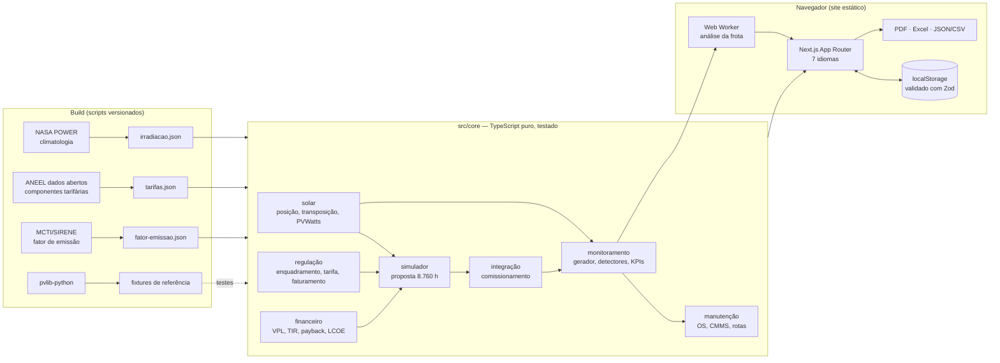

# Irradiance Works

> **English summary.** Irradiance Works is a portfolio web app for Brazilian distributed solar. A grid-tied PV **simulator** for low-voltage (Group B) consumers produces an 8,760-hour simulation, ANEEL tariff breakdown, Law 14,300 "Fio B" billing, financial scenarios, a PDF proposal and an Excel workbook with live formulas. A **fleet monitoring** module runs fault detectors on synthetic 5-minute telemetry, ranks losses in BRL and hands qualified work orders to a CMMS. A proposal can be **commissioned** into a monitored plant and tracked as *promised vs actual*. Both modules share one pure, tested TypeScript core. Every number traces to a documented formula, an editable assumption or a cited official source (NASA POWER, ANEEL open data, MCTI). The site is fully static (GitHub Pages), runs entirely in the browser and is available in 7 languages (pt, en, es, de, it, fr, zh). 703 unit tests, 50 end-to-end tests, Lighthouse 98–100 on desktop.
>
> **Live demo:** https://leocarvalhomagalhaes.github.io/irradiance-works/

Aplicação de portfólio que liga duas etapas da geração distribuída solar: **vender** (dimensionar e propor) e **operar** (monitorar, achar perdas e mandar a manutenção certa). As duas usam o mesmo núcleo de cálculo, então a promessa da proposta e o desempenho monitorado se comparam com a mesma régua.

Plantas, clientes, fabricantes e medições de monitoramento são **fictícios** (dados sintéticos). Tarifas, irradiação, fator de emissão e regras são **dados oficiais**, com fonte e data. Valores sem fonte oficial aparecem marcados como *premissa* e são editáveis.

## Módulos

| Módulo | O que faz |
|---|---|
| **Simulador** | Assistente em 3 etapas (local e ligação, consumo e tarifa, instalação) → simulação horária de 8.760 h, decomposição tarifária ANEEL (TE, TUSD Fio A/B, encargos, tributos), enquadramento (micro/mini, GD I/II/III, fora do SCEE), faturamento mês a mês com créditos de 60 meses, três cenários de aquisição (à vista, financiado, custo + taxa), regra pós-2029 em três cenários, tornado de sensibilidade, memorial elétrico com substituição numérica, proposta em PDF e planilha Excel com fórmulas vivas. Importa medição horária ou de 15 min (CSV). |
| **Monitoramento** | Frota de 18 usinas sintéticas (16 de GD e 2 acima de 5 MW com SCADA somente leitura). Telemetria de 5 min por inversor e MPPT, perda de comunicação com reenvio do datalogger, alarmes de fabricante mapeados em categorias padrão, sensor virtual entre usinas vizinhas, KPIs da IEC 61724-1, cascata mensal de perdas em kWh e R$, recomendação de limpeza por T* = √(2C/r), restrições do ONS classificadas pela Lei 15.269/2025. |
| **Manutenção** | Ordens de serviço qualificadas a partir dos alertas (ativo, procedimento, checklist, prioridade por R$/dia), exportação JSON/CSV em esquema versionado para o CMMS, importação das OS concluídas, verificação do resultado pela geração, rotas de limpeza e indicadores de manutenção. |
| **Integração** | "Comissionar esta usina" transforma uma proposta em usina monitorada com histórico simulado; o painel *prometido × real* decompõe o desvio em clima, perdas operacionais e resíduo. |
| **Metodologia** | Página com todas as fórmulas, fontes, regras com artigo citado, premissas não confirmadas e a validação dos detectores calculada ao vivo. |

## Arquitetura



- **Sem servidor e sem requisições externas durante a navegação.** Tudo roda no navegador; a única exceção é o mapa da frota (blocos do OpenStreetMap), carregado só quando o usuário pede.
- **Dados externos entram no build**, por scripts reproduzíveis em `scripts/`, e ficam versionados em `src/data/` com fonte, licença e data de obtenção.
- **O monitoramento é determinístico.** Um gerador `(usina, dia, eventos) → leituras` produz 12 meses de telemetria; as falhas injetadas têm rótulo, o que permite medir os detectores. OS concluídas viram eventos do gerador, e a geração depois da manutenção muda de fato.

## Validação e resultados

Números reais, medidos em 26/10/2026.

**Testes**

| Conjunto | Resultado |
|---|---|
| Unitários (Vitest), incluindo núcleo solar contra pvlib-python, faturamento e fluxo de caixa contra planilha independente, paridade dos 7 dicionários | **703 aprovados** |
| Ponta a ponta (Playwright): fluxo proposta → PDF/Excel → comissionamento → alerta → OS → manutenção; 7 idiomas em desktop e celular, com PDF e sem rolagem horizontal; axe (WCAG 2.2 AA) em tema claro e escuro; teclado; movimento reduzido | **50 aprovados** |

**Detectores de falha** (frota de demonstração, 17 falhas rotuladas; recalculado ao vivo na página de metodologia)

| Tipo | Falhas | Detectadas | Precisão | Revocação | Atraso médio |
|---|---:|---:|---:|---:|---:|
| Alarmes (isolamento, rede, sobretemperatura, arco) | 4 | 4 | 1,00 | 1,00 | 0 d |
| Inversor parado sem alarme | 1 | 1 | 1,00 | 1,00 | 0 d |
| Perda de comunicação | 3 | 3 | 1,00 | 1,00 | 0 d |
| String desligada | 2 | 2 | 1,00 | 1,00 | 1 d |
| Subdesempenho de inversor (SCADA) | 1 | 1 | 1,00 | 1,00 | 2 d |
| Sombreamento recorrente | 1 | 1 | 1,00 | 1,00 | 5 d |
| Clipping | 1 | 1 | 1,00 | 1,00 | 9 d |
| Sujidade | 3 | 3 | 0,60 | 1,00 | 33 d |
| Degradação acelerada | 1 | 1 | 1,00 | 1,00 | 260 d |
| **Total** | **17** | **17** | **0,90** | **1,00** | 22 d |

A sujidade gera dois alertas a mais que o rótulo (precisão 0,60): sem piranômetro, o erro diário de 6 % da irradiância modelada confunde parte da tendência. A degradação acelerada é detectada só depois de meses, porque exige tendência significativa em dias limpos.

**Lighthouse 12.8** (servidor estático com gzip, como o GitHub Pages; uma execução por linha; variação de até ±10 pontos entre execuções no celular)

| Rota | Dispositivo | Desempenho | Acessibilidade | Boas práticas | SEO | LCP | TBT |
|---|---|---:|---:|---:|---:|---:|---:|
| Início | celular | 93 | 100 | 100 | 100 | 3,0 s | 130 ms |
| Início | desktop | 100 | 100 | 100 | 100 | 0,7 s | 0 ms |
| Simulador | celular | 73 | 100 | 100 | 100 | 4,4 s | 460 ms |
| Simulador | desktop | 99 | 100 | 100 | 100 | 0,9 s | 60 ms |
| Frota | celular | 87 | 100 | 100 | 100 | 3,5 s | 230 ms |
| Frota | desktop | 100 | 100 | 100 | 100 | 0,7 s | 0 ms |
| Detalhe da usina | celular | 74 | 100 | 100 | 100 | 4,5 s | 420 ms |
| Detalhe da usina | desktop | 98 | 100 | 100 | 100 | 0,8 s | 40 ms |
| Manutenção | celular | 85 | 100 | 100 | 100 | 3,6 s | 270 ms |
| Metodologia | celular | 88 | 100 | 100 | 100 | 3,5 s | 180 ms |

**JavaScript por rota** (gzip, `node scripts/medir-bundle.mjs`): início 243 KiB · metodologia 333 KiB · manutenção 340 KiB · frota 341 KiB · detalhe da usina 477 KiB · simulador 511 KiB. A geração de PDF e de Excel é carregada só no clique; a análise da frota (12 meses × 18 usinas, ~4 s) roda num Web Worker.

## Como rodar

Requisitos: Node 24 e npm. Python 3.12+ só para regenerar referências e fontes.

```bash
npm ci
npm run dev            # http://localhost:3000/pt/
npm test               # testes unitários
npm run build          # exportação estática em out/
node scripts/servir-estatico.mjs 4173   # serve out/ como o GitHub Pages
npm run test:e2e       # Playwright (usa o servidor acima)
npx playwright install chromium         # na primeira vez
```

Atualizar dados oficiais (requisições externas; o resultado é versionado):

```bash
npm run dados:irradiacao   # NASA POWER, 73 cidades
npm run dados:tarifas      # ANEEL, componentes tarifárias
npm run dados:emissao      # MCTI/SIRENE
node scripts/gerar-licencas.mjs
```

Referências de validação e fontes do PDF (Python):

```bash
python -m venv scripts/referencia/.venv
scripts/referencia/.venv/bin/pip install -r scripts/referencia/requirements.txt
scripts/referencia/.venv/bin/python scripts/referencia/gerar_fixtures.py
scripts/referencia/.venv/bin/python scripts/referencia/paridade_planilha.py
scripts/referencia/.venv/bin/python scripts/gerar-fontes-pdf.py   # confere a cobertura de glifos dos 7 idiomas
```

**Publicação.** O workflow `.github/workflows/pages.yml` roda lint, tipos, testes unitários e de ponta a ponta em todo push e PR. No `main`, gera o build com o caminho base do Pages (`NEXT_PUBLIC_BASE_PATH`, `NEXT_PUBLIC_SITE_URL`) e publica.

## Estrutura

```
src/core/        núcleo de cálculo (solar, regulação, financeiro, simulador, monitoramento, manutenção, integração)
src/data/        dados oficiais extraídos no build + frota e catálogo sintéticos
src/i18n/        configuração e dicionários dos 7 idiomas
src/app/[lang]/  páginas (exportação estática por idioma)
src/components/  interface (shadcn/ui + Radix, Recharts, Motion)
src/workers/     análise da frota fora da thread principal
scripts/         coleta de dados, referências pvlib, fontes do PDF, licenças, utilitários de build
tests/unit/      Vitest       tests/e2e/   Playwright      tests/fixtures/   referências
```

## Decisões de projeto

- **Simulação horária, não mensal.** O autoconsumo instantâneo não paga Fio B; sem a curva hora a hora, a economia sob a Lei 14.300 sai errada.
- **Faturamento pela REN 1.000, art. 655-I.** Custo de disponibilidade como piso, créditos FIFO com validade de 60 meses e compensação limitada para a fatura não ficar abaixo do piso.
- **Regra pós-2029 como cenário editável.** A ANEEL ainda não regulamentou o art. 17; o padrão (Fio B 100 %) é sinalizado, e o tornado mostra quanto isso pesa no VPL.
- **Sensor virtual por cidade.** O erro da irradiância modelada é comum à cidade, e a mediana das vizinhas o corrige. Usinas isoladas recebem o aviso de que a detecção de sujidade é menos sensível.
- **PR estimado ≠ PR medido.** Usinas de GD sem piranômetro mostram PR *estimado*; só as usinas com estação meteorológica exibem o PR da IEC 61724-1.
- **SCADA somente leitura.** A aplicação importa histórico e nunca envia comandos, por segurança de redes industriais.
- **O app não substitui o CMMS.** Ele cria a OS qualificada, exporta, importa a conclusão e verifica o efeito na geração; MTTR e MTBF ficam no CMMS.
- **Acessibilidade.** Status nunca só por cor (ícone + texto), todo gráfico tem título, descrição e tabela "Ver dados", paleta validada para daltonismo nos dois temas, foco gerenciado no assistente, respeito a `prefers-reduced-motion`.

## Limitações e premissas não confirmadas

- Alíquotas de ICMS, PIS e COFINS são exemplos editáveis.
- Os descontos por categoria de GD das resoluções tarifárias não estão nos dados abertos; aplicam-se os percentuais da Lei 14.300 aos componentes oficiais.
- Perfis de carga, custos (R$/Wp, O&M, troca de inversor, limpeza) e taxas financeiras são premissas ilustrativas; equipamentos são genéricos.
- O texto da REN 1.000 foi lido numa compilação publicada por distribuidora, porque o portal da ANEEL bloqueia acesso automatizado.
- Grupo A, Tarifa Branca, múltiplas unidades com rateio de créditos e sombreamento 3D não estão implementados; a comparação com o CRESESB SunData não foi feita (sem interface para consulta automatizada).
- No celular, o simulador e o detalhe da usina ficam em 73–74 no Lighthouse, limitados pelo tempo de execução do JavaScript (TBT de 420–460 ms).

## Próximos passos

- Geração P50/P90 e incerteza do recurso solar.
- Grupo A (horo-sazonal e demanda), baterias para corte de ponta e comparação GD × mercado livre.
- Adaptadores de entrada para APIs reais de inversores e dataloggers.
- Dividir o pacote do simulador para reduzir o TBT no celular.

## Licenças

Dependências, dados e fontes tipográficas de terceiros estão em [THIRD_PARTY_LICENSES.md](THIRD_PARTY_LICENSES.md) e na página de metodologia; dados da ANEEL sob ODbL 1.0.
